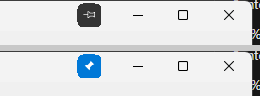

# 📌 PinTop

Añade un botón **📌** a la barra de título de cualquier ventana de Windows para dejarla
**siempre encima de todo**, aunque hagas clic en otra aplicación.

Ideal para tener una ventana pequeña de referencia (un PDF, una web, un pedido, una calculadora…)
flotando mientras rellenas datos en otra a pantalla completa, sin pantalla dividida.



## Funciones

- **Botón 📌** junto a minimizar / maximizar / cerrar de la ventana activa.
  - Gris = normal · Azul = fijada encima de todo.
- **Atajo global `Ctrl + Alt + P`**: fija o suelta la ventana activa.
- **Clic derecho en el botón → Opacidad** (100 % … 50 %) para ver lo que hay detrás.
- Icono en la bandeja del sistema:
  - Mostrar/ocultar el botón (también con doble clic en el icono).
  - Soltar todas las ventanas fijadas.
  - Iniciar con Windows.
- Al salir, **devuelve todas las ventanas a su estado normal** (sin fijar y opacas).
- Un único `.exe` pequeño, sin instalación ni dependencias.

## Uso

1. Descarga o compila `PinTop.exe` y ejecútalo.
2. Haz clic en cualquier ventana: aparecerá el botón 📌 en su barra de título.
3. Púlsalo para fijarla. Vuelve a pulsarlo para soltarla.

## Compilar

No hace falta instalar Visual Studio ni el SDK de .NET: se usa el compilador de C#
que trae Windows (.NET Framework 4.8).

```powershell
.\build.ps1
```

El ejecutable queda en `bin\PinTop.exe`.

`tools\make-icon.ps1` regenera `assets\pintop.ico` si se cambia el diseño del icono.

## Cómo funciona

| Archivo | Qué hace |
| --- | --- |
| `src/Program.cs` | Punto de entrada; evita abrir dos instancias. |
| `src/TrayApp.cs` | Icono de bandeja, menús, atajo de teclado y seguimiento de la ventana activa con `SetWinEventHook`. |
| `src/PinButton.cs` | El botón flotante: una ventana sin bordes que nunca roba el foco (`WS_EX_NOACTIVATE`). |
| `src/WindowManager.cs` | Decide en qué ventanas mostrar el botón, calcula su posición (`DWMWA_CAPTION_BUTTON_BOUNDS`), fija (`HWND_TOPMOST`) y aplica opacidad (`SetLayeredWindowAttributes`). |
| `src/Support.cs` | Atajo global, arranque con Windows e icono de la bandeja. |
| `src/Native.cs` | Declaraciones de la API de Win32. |

## Limitaciones conocidas

- Las ventanas de programas ejecutados **como administrador** solo se pueden fijar si PinTop
  también se ejecuta como administrador (restricción de seguridad de Windows).
- En apps con barra de título personalizada (Chrome, Discord, Spotify…) el botón se coloca
  estimando la posición de los botones estándar; en algunas puede quedar algo desplazado.
- Algunas ventanas que ya usan transparencia propia no admiten el cambio de opacidad.
- No se muestra en juegos o vídeos a pantalla completa.

## Ideas para siguientes versiones

- Modo "click-through" (que los clics atraviesen la ventana fijada).
- Recordar qué aplicaciones fijar automáticamente.
- Atajo de teclado configurable y color de acento del sistema.

## Licencia

[MIT](LICENSE)
